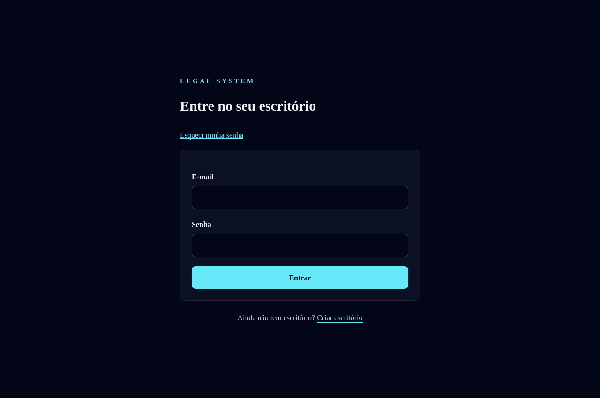
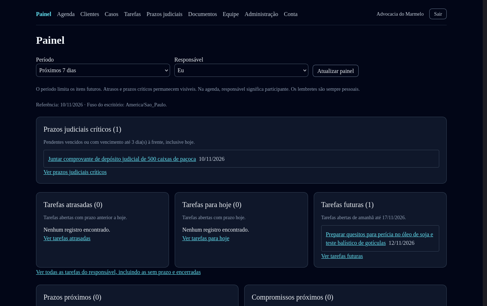
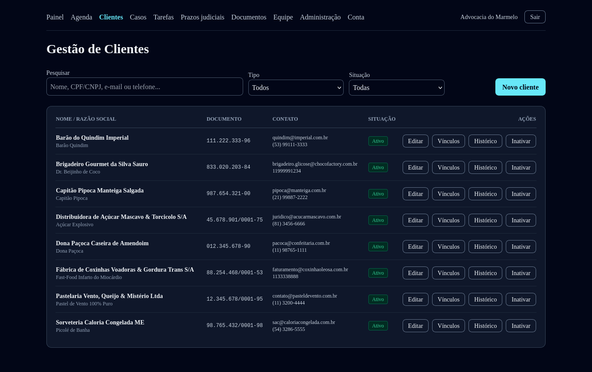
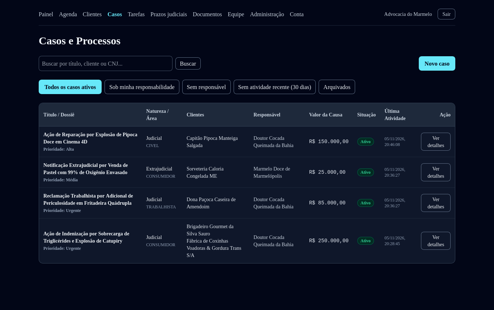
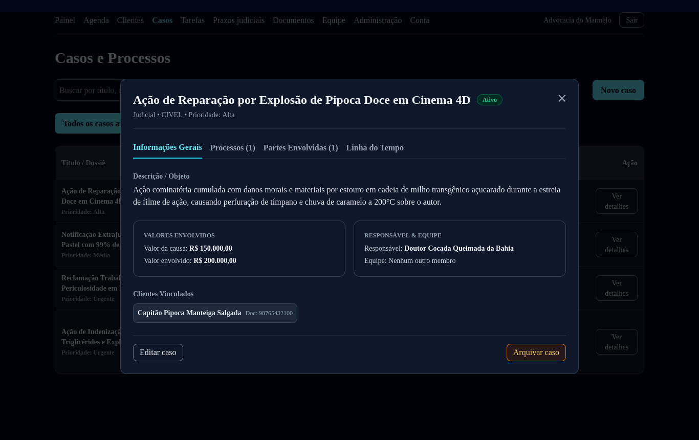
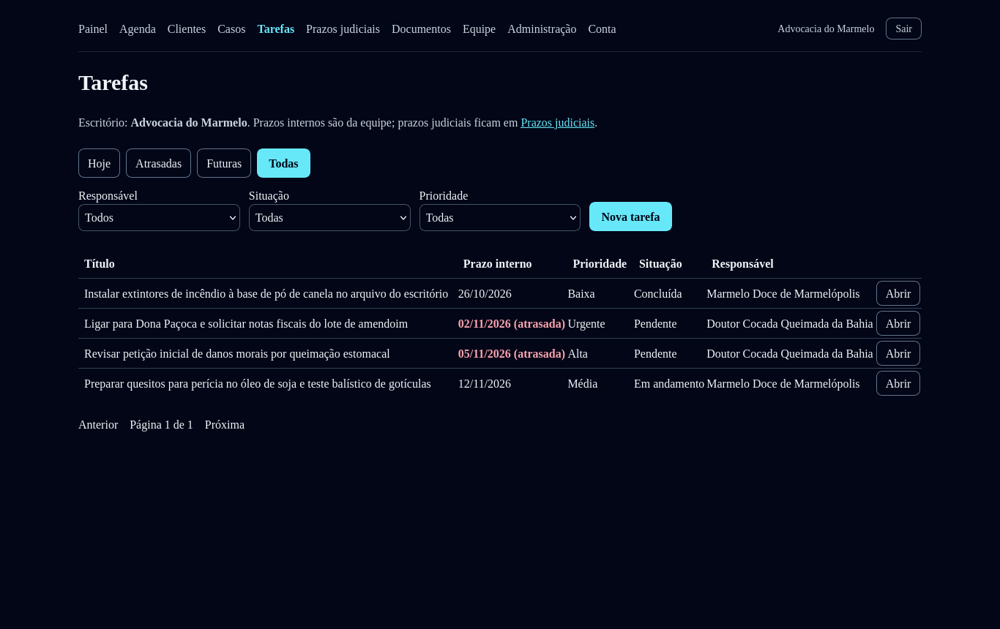
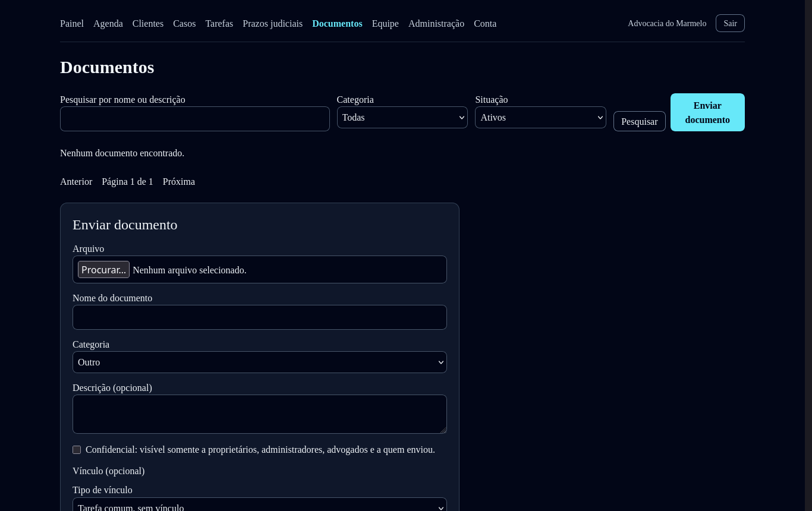
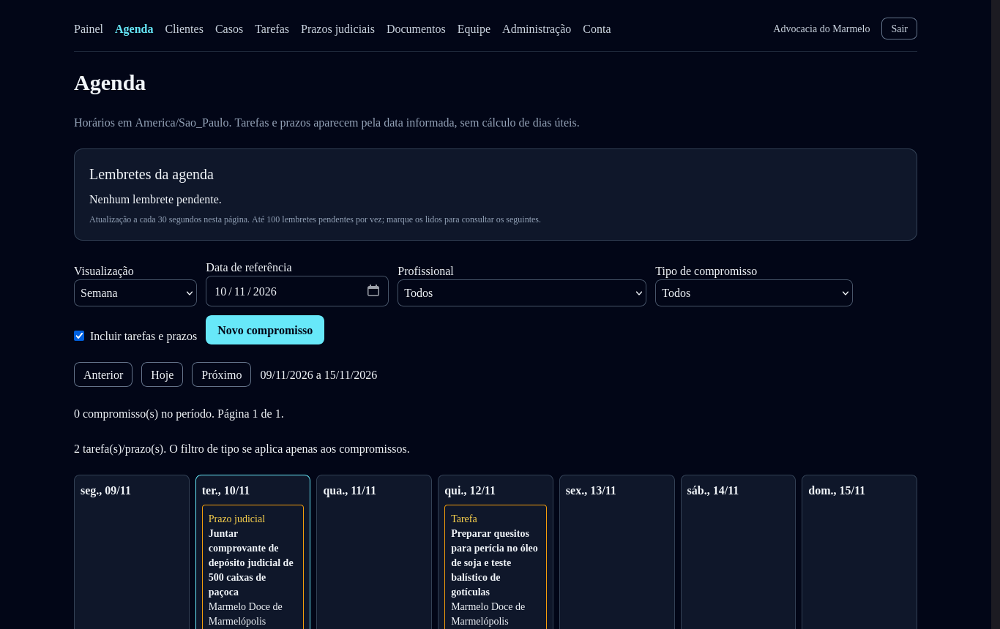
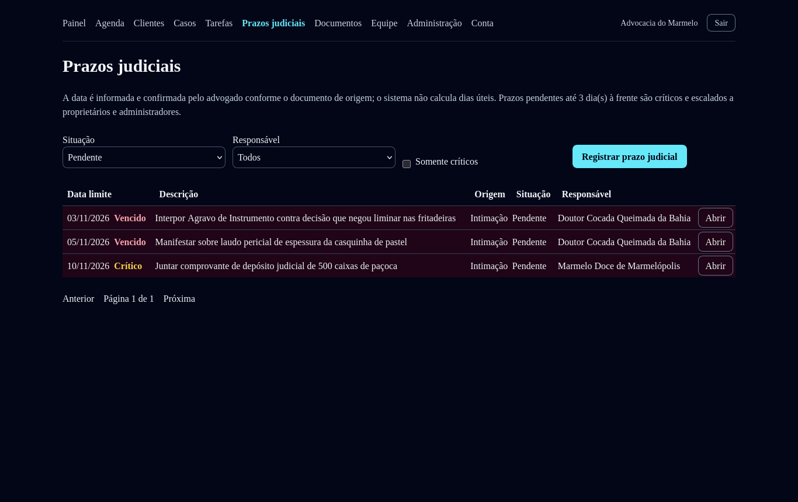

# UNIVERSIDADE FEDERAL DE LAVRAS
## DEPARTAMENTO DE CIÊNCIA DA COMPUTAÇÃO
### EMPREENDEDORISMO EM SISTEMAS DE INFORMAÇÃO (2026/2)

**Orientador:** Prof. Johnatan Oliveira  
**Data:** 10 de novembro de 2026  
**Local:** Lavras - MG  

---

# WEB-DIREITO
## ENTREGA 4: MVP FUNCIONAL E VALIDAÇÃO DA SOLUÇÃO

**Integrantes da Equipe:**
- Augusto Fernandes Carvalho
- Alexandre Bortone
- Lucas Marcelino Neves
- Matheus Pimenta
- Diovani Da Cruz Mangia

**Repositório Oficial:** [https://github.com/LucasNevesdv/Web-Direito](https://github.com/LucasNevesdv/Web-Direito)

---

## 1. OBJETIVO DA ETAPA E CONTINUIDADE DO PROJETO

A Entrega 4 do projeto **Web-Direito** tem como finalidade apresentar o Produto Mínimo Viável (MVP) em estado funcional e demonstrável, capaz de executar de ponta a ponta a jornada principal definida na Entrega 3, além de relatar os resultados obtidos na validação desse fluxo com representantes do público-alvo.

A pergunta central que norteia esta etapa avaliativa é:
> *"Quando usuários representativos utilizam o MVP, eles conseguem perceber o valor que imaginamos?"*

Nas etapas anteriores, a Entrega 1 identificou a perda de controle sobre tarefas, prazos e documentos como um problema latente em pequenos escritórios de advocacia. A Entrega 2 aprofundou essa investigação através de 8 entrevistas semiestruturadas com sócios, advogados, assistentes e estagiários, consolidando que a dispersão de informações e a falta de visibilidade sobre a etapa de **revisão** eram os principais geradores de retrabalho e insegurança operacional. Na Entrega 3, a equipe formalizou a proposta de valor, o modelo de negócio (BMC) e o escopo do MVP, desenhando uma jornada de 7 passos centrada na coordenação de demandas forenses compartilhadas.

Com o MVP desenvolvido e integrado, esta quarta entrega comprova a execução prática do software e avalia a percepção de utilidade e facilidade de uso do sistema por meio de testes de usabilidade estruturados.

---

## 2. ARQUITETURA, AMBIENTE E INSTRUÇÕES DE EXECUÇÃO

O software foi construído seguindo rigorosamente os princípios da **Clean Architecture** (Arquitetura Limpa), garantindo isolamento absoluto das regras de negócio em relação a frameworks e provedores de banco de dados, em conformidade com o requisito não-funcional de isolamento multi-tenant (`RN-001` a `RN-004`).

### 2.1. Visão Geral da Stack Tecnológica
- **Backend**: Node.js (>= 20.19 / 22), TypeScript 5.6, Fastify 5 (baixo overhead e alta performance de I/O), Prisma ORM 6.19.3, Argon2id para derivação segura de senhas e tokens JWT (`jose`) em memória.
- **Banco de Dados**: PostgreSQL 16+ com 14 migrações versionadas, constraints relacionais estritas por escritório (`office_id`) e triggers SQL duráveis para trilha de auditoria imutável.
- **Frontend**: Single Page Application (SPA) responsiva em React 18, Vite 5 e Tailwind CSS, equipada com coordenador de sessões multi-abas baseado em `BroadcastChannel` e `Web Locks` API.
- **Suíte de Testes Automatizados**: Vitest cobrindo 821 testes unitários, de rotas e de integração ponta a ponta (662 no backend e 159 no frontend), além de suítes de verificação concorrente contra PostgreSQL real.

### 2.2. Instruções de Instalação e Execução Local
O sistema foi concebido para execução ágil em ambiente de desenvolvimento local, sem dependência de serviços externos pagos ou infraestrutura de produção complexa:

1. **Clonar o Repositório**:
   ```bash
   git clone https://github.com/LucasNevesdv/Web-Direito.git
   cd Web-Direito
   ```

2. **Instalação das Dependências (via pnpm workspace)**:
   ```bash
   pnpm install
   ```

3. **Configuração de Variáveis de Ambiente**:
   Copiar o arquivo de exemplo do backend para configurar o acesso ao PostgreSQL local:
   ```bash
   cp src/backend/.env.example src/backend/.env
   # Ajustar a variável DATABASE_URL com usuário e senha do seu PostgreSQL local
   ```

4. **Aplicação das Migrations e Geração do Prisma Client**:
   ```bash
   cd src/backend
   pnpm run prisma:generate
   pnpm exec prisma migrate deploy
   ```

5. **Injeção da Base de Dados de Demonstração (Mock Seed)**:
   O projeto conta com um script automatizado que popula o banco com um escritório ativo de demonstração (*Advocacia do Marmelo*), composto por 8 clientes PF/PJ, 5 casos judiciais, 4 processos CNJ, 4 tarefas com prazos e 3 prazos judiciais:
   ```bash
   pnpm run seed:dev
   ```

6. **Inicialização Conjunta (Backend + Frontend)**:
   A partir da pasta raiz `src/`:
   ```bash
   pnpm run dev
   ```
   - **Frontend**: acessível em `http://localhost:5173`
   - **Backend API**: ativo em `http://127.0.0.1:3000`

7. **Credenciais Pré-Configuradas para Demonstração**:
   - **E-mail do Proprietário**: `marmelo@gmail.com`
   - **Senha**: `SenhaForte@123`
   - **E-mail do Advogado Associado**: `cocada@advogado.com.br`

---

## 3. DEMONSTRAÇÃO DO FLUXO PRINCIPAL DE PONTA A PONTA

O fluxo operacional do Web-Direito foi desenhado para eliminar o atrito comum em softwares jurídicos legados, permitindo que a equipe cumpra o ciclo completo de uma demanda forense sem dispersão de telas. A seguir, apresenta-se a comprovação visual do funcionamento de cada etapa:

### Etapa 1: Acesso e Autenticação no Escritório
O usuário inicia a sessão através de autenticação segura baseada em JWT efêmero em memória e renovação via cookie seguro `HttpOnly`. O backend valida estritamente a origem da requisição e garante que todo o contexto de dados subsequente pertença exclusivamente ao escritório autenticado.


*Figura 1 — Tela de acesso seguro ao escritório com suporte a recuperação e primeiro acesso.*

---

### Etapa 2: Painel Operacional Unificado (Dashboard)
Ao ingressar, o advogado ou gestor visualiza instantaneamente as prioridades do dia: tarefas pendentes, tarefas futuras e o quadro de **Prazos Judiciais Críticos** (destacando em vermelho demandas com vencimento fatal em até 3 dias). Essa visão atende à principal dor relatada pelos participantes P01 e P06 na validação do problema.


*Figura 2 — Painel operacional com prazos judiciais críticos e agrupamento de tarefas do dia.*

---

### Etapa 3: Gestão Centralizada de Clientes
O cadastro de clientes suporta Pessoas Físicas (CPF) e Pessoas Jurídicas (CNPJ), com validação algorítmica de dígitos verificadores e garantia de unicidade dentro do escritório. A listagem permite busca instantânea por nome, documento ou telefone, além de acesso direto a contatos e histórico.


*Figura 3 — Listagem de clientes com pesquisa reativa, filtros por tipo/situação e ações rápidas.*

---

### Etapa 4: Cadastro de Casos e Processos Judiciais (CNJ)
Cada demanda interna gera um **Caso** (que pode ser judicial, extrajudicial, administrativo ou consultivo). Vinculados ao caso estão os clientes atendidos, o advogado responsável e o número de processo no padrão CNJ (20 dígitos). O modal de detalhes reúne valores envolvidos, partes contrárias e a linha do tempo do processo.


*Figura 4 — Listagem de casos com filtros por responsabilidade e status operacional.*


*Figura 5 — Modal de detalhes do caso com dados processuais, partes contrárias e linha do tempo.*

---

### Etapa 5: Distribuição e Execução de Tarefas com Fluxo de Revisão
O módulo de tarefas materializa o diferencial do Web-Direito: cada atividade possui **executor** e **revisor** distintos. Uma tarefa com revisão pendente não pode ser encerrada prematuramente como concluída pelo executor, evitando que minutas incompletas sejam protocoladas. Prazos internos vencidos são destacados visualmente para rápida identificação.


*Figura 6 — Controle de tarefas com indicação explícita de atrasos, prioridades e responsáveis.*

---

### Etapa 6: Gestão de Documentos e Versionamento Vinculado
Os documentos do escritório são enviados diretamente vinculados ao cliente ou ao caso correspondente. O sistema armazena metadados estruturados, controla versões de forma incremental (v1, v2, v3...) e permite restringir documentos sob sigilo confidencial.


*Figura 7 — Interface de upload de documentos com categorização e vinculação ao caso/cliente.*

---

### Etapa 7: Agenda Semanal Unificada e Prazos Judiciais
A Agenda consolida em uma grade temporal tanto os compromissos com hora marcada quanto as tarefas e os prazos processuais fatais. O sistema sinaliza sobreposições de horários e permite que o advogado visualize a semana completa sem recorrer a agendas externas.


*Figura 8 — Agenda semanal integrada com prazos judiciais fatais e tarefas internas.*


*Figura 9 — Tela dedicada de Prazos Judiciais com alerta de prazos vencidos e críticos.*

---

## 4. METODOLOGIA E PROTOCOLO DE VALIDAÇÃO COM USUÁRIOS

Para avaliar a percepção de valor e usabilidade do MVP, a equipe aplicou o protocolo planejado na Entrega 3 (Quadro 7 e Quadro 8), convidando 5 representantes do público-alvo com perfis complementares na rotina forense.

### 4.1. Cenário Padronizado Fornecido
Cada participante recebeu um cenário prático padronizado típico da rotina de um escritório de advocacia:
> *"O escritório assumiu a defesa da cliente Dona Paçoca em uma demanda cível urgente. É necessário localizar o cadastro da cliente, conferir o caso já cadastrado, distribuir a elaboração de uma petição com prazo para o colega, definir a data de revisão e localizar a próxima pendência no painel."*

### 4.2. As Cinco Tarefas Solicitadas
1. **Tarefa T1**: Localizar o cliente na base e abrir o caso relacionado.
2. **Tarefa T2**: Acessar o módulo de documentos e iniciar a anexação de uma procuração vinculada à demanda.
3. **Tarefa T3**: Distribuir uma nova tarefa com executor, revisor, prioridade e prazo interno.
4. **Tarefa T4**: Verificar a situação de uma tarefa e identificar se ela já pode ser dada como finalizada sem revisão.
5. **Tarefa T5**: Consultar o painel inicial e identificar o prazo judicial crítico mais próximo.

### 4.3. Critérios de Sucesso Estabelecidos
- Pelo menos 4 de 5 participantes concluem as tarefas centrais sem intervenção direta do observador.
- Pelo menos 4 de 5 compreendem que "elaboração concluída" não encerra a tarefa sem o crivo do revisor.
- Avaliação média de utilidade superior a 4 em escala Likert de 1 a 5.

---

## 5. FICHAS DETALHADAS DOS TESTES DE USABILIDADE

Abaixo estão descritas as sessões individuais realizadas com os 5 participantes convidados (`U01` a `U05`), correlacionados às personas estruturadas nas etapas anteriores do projeto.

---

### Ficha de Teste U01
- **Participante:** Dr. Roberto M. (Sócio Fundador / Gestor — Escritório com 3 pessoas)
- **Correlação:** Perfil `P01` (Entrega 2)
- **Objetivo da Sessão:** Avaliar a visão de governança, o controle de prazos críticos e a velocidade de distribuição de tarefas.

| Parâmetro | Registro Observado |
| :--- | :--- |
| **Comportamento e Execução** | Navegou com facilidade pelo menu superior. No Dashboard, elogiou de imediato a caixa de *Prazos Judiciais Críticos* em destaque. Completou a busca do cliente em menos de 1 minuto. Na criação da tarefa, elogiou a existência do campo separado para "Revisor". |
| **Dificuldade Encontrada** | Na tela de Casos, tentou clicar diretamente na linha da tabela antes de perceber o botão "Ver detalhes". Sugeriu tornar toda a linha clicável. |
| **Comentário Verbal** | *"O que mais me chamou a atenção foi ver os prazos críticos logo na primeira tela. No sistema que uso hoje, preciso abrir três relatórios para ter certeza de que nada vence amanhã."* |
| **Tempo Total do Fluxo** | 7 minutos e 20 segundos |
| **Percepção de Valor** | **Nota 5 / 5** — Valor imediato na prevenção de perdas de prazos e no controle da equipe. |
| **Sugestão do Participante** | Adicionar um filtro rápido na Agenda para ocultar tarefas rotineiras e ver exclusivamente prazos fatais da OAB. |
| **Decisão da Equipe** | Implementar a opção de linha inteira clicável na tabela de casos e incluir filtro exclusivo de prazos fatais no roadmap. |

---

### Ficha de Teste U02
- **Participante:** Dra. Mariana T. (Advogada Associada Plena — Equipe de 6 advogados)
- **Correlação:** Perfil `P03` (Entrega 2)
- **Objetivo da Sessão:** Avaliar a dinâmica de elaboração de peças, checklist e a eficácia da etapa de revisão.

| Parâmetro | Registro Observado |
| :--- | :--- |
| **Comportamento e Execução** | Focou diretamente no módulo de Tarefas. Ao realizar a conclusão da redação de uma petição de teste, observou o status "Aguardando Revisão". Compreendeu perfeitamente que sua responsabilidade de redatora encerrava ali, mas que a demanda continuava aberta para o sócio revisor. |
| **Dificuldade Encontrada** | Sentiu falta de um campo para inserir um link direto ou anexo do arquivo de minuta dentro do formulário da tarefa, tendo que ir até a tela de documentos. |
| **Comentário Verbal** | *"Essa trava de revisão é excelente. No nosso escritório já aconteceu de estagiário achar que terminou a peça e ela ficar parada sem protocolo porque ninguém foi avisado para revisar."* |
| **Tempo Total do Fluxo** | 8 minutos e 05 segundos |
| **Percepção de Valor** | **Nota 5 / 5** — Elimina a confusão entre peça redigida e peça protocolada. |
| **Sugestão do Participante** | Permitir que o revisor aprove a tarefa e já marque diretamente a data de protocolo final. |
| **Decisão da Equipe** | Integrar um atalho de upload direto de minuta na tela de detalhes da tarefa na próxima versão. |

---

### Ficha de Teste U03
- **Participante:** Camila S. (Assistente Administrativa e Secretária Forense)
- **Correlação:** Perfil `P04` (Entrega 2)
- **Objetivo da Sessão:** Avaliar a agilidade no atendimento inicial, cadastro de clientes, telefone/e-mail e organização de documentos.

| Parâmetro | Registro Observado |
| :--- | :--- |
| **Comportamento e Execução** | Executou com muita rapidez o cadastro de cliente e a consulta por CNPJ. Ao acessar o módulo de documentos, apreciou a seleção de categoria (Procuração, Contrato, Petição) e o checkbox de sigilo "Confidencial". |
| **Dificuldade Encontrada** | Na tela de documentos, hesitou por alguns segundos para entender se o vínculo deveria ser com o cliente ou diretamente com o caso. |
| **Comentário Verbal** | *"A busca de clientes é super rápida, não trava como a planilha compartilhada que usamos quando duas pessoas editam juntas."* |
| **Tempo Total do Fluxo** | 6 minutos e 45 segundos |
| **Percepção de Valor** | **Nota 4 / 5** — Muito prático para o cadastro e organização de arquivos, mas pediu avisos mais claros de salvamento. |
| **Sugestão do Participante** | Exibir um toast ou mensagem flutuante verde confirmando que o documento foi salvo com sucesso. |
| **Decisão da Equipe** | Adicionar feedback visual imediato (toast de sucesso) em todas as operações de gravação de arquivos e cadastros. |

---

### Ficha de Teste U04
- **Participante:** Dr. Carlos Eduardo B. (Sócio Administrador — Escritório com 5 integrantes)
- **Correlação:** Perfil `P06` (Entrega 2)
- **Objetivo da Sessão:** Avaliar a curva de aprendizado, custo de adoção e confiança nas informações de prazos.

| Parâmetro | Registro Observado |
| :--- | :--- |
| **Comportamento e Execução** | Avaliou com rigor a clareza da tipografia e o contraste escuro da interface. Gostou de não ser obrigado a preencher dezenas de campos burocráticos para abrir um caso. Validou que os prazos internos são independentes dos prazos judiciais. |
| **Dificuldade Encontrada** | Questionou se o sistema realizava a contagem automática de feriados locais e dias úteis. Ao ser esclarecido de que no MVP a data é informada e confirmada pelo advogado conforme a publicação, concordou que isso evita erros de interpretação de regras dos tribunais. |
| **Comentário Verbal** | *"Softwares tradicionais prometem contagem automática e vivem errando feriados regimentais. Prefiro que o sistema me mostre a data que eu conferi no Diário da Justiça, desde que não me deixe esquecer dela."* |
| **Tempo Total do Fluxo** | 9 minutos e 15 segundos |
| **Percepção de Valor** | **Nota 4 / 5** — Interface limpa, direta ao ponto e sem excesso de cliques. |
| **Sugestão do Participante** | Possibilidade de exportar a lista de prazos da semana em PDF para levar para a reunião de equipe. |
| **Decisão da Equipe** | Incluir a exportação da pauta semanal de prazos na lista de melhorias para a Entrega 5. |

---

### Ficha de Teste U05
- **Participante:** Lucas V. (Estagiário de Direito — 8º Período)
- **Correlação:** Perfil `P07` (Entrega 2)
- **Objetivo da Sessão:** Avaliar a experiência do colaborador que executa tarefas e consulta pendências cotidianas.

| Parâmetro | Registro Observado |
| :--- | :--- |
| **Comportamento e Execução** | Acessou diretamente a aba "Tarefas", filtrando por "Eu". Identificou prontamente a atividade a ser realizada, os itens do checklist e a data limite. Ao preencher as notas de andamento, compreendeu que precisava solicitar a conferência do advogado responsável. |
| **Dificuldade Encontrada** | Na visualização padrão de tarefas, estava selecionada a aba "Hoje", que não possuía itens no momento do teste. Precisou clicar em "Futuras" ou "Todas" para localizar a demanda. |
| **Comentário Verbal** | *"Ficou bem intuitivo. No WhatsApp a gente se perde porque o advogado manda áudio com a instrução e a gente esquece onde estava o prazo. Aqui fica tudo na tela."* |
| **Tempo Total do Fluxo** | 6 minutos e 10 segundos |
| **Percepção de Valor** | **Nota 5 / 5** — Clareza absoluta sobre o que fazer e quem cobrar pela revisão. |
| **Sugestão do Participante** | Mostrar um contador numérico nos botões das abas (ex: "Hoje (0)", "Futuras (3)", "Todas (4)") para o usuário já saber onde há tarefas. |
| **Decisão da Equipe** | Adicionar contadores numéricos (badges) nos filtros de tarefas e prazos. |

---

## 6. CONSOLIDAÇÃO DOS RESULTADOS E MÉTRICAS

A compilação dos dados registrados durante as 5 sessões evidencia um desempenho consistente do MVP funcional, atendendo e superando as metas preliminares estabelecidas no plano da Entrega 3.

### 6.1. Taxa de Conclusão por Tarefa
Todos os participantes completaram a jornada de ponta a ponta. Houve apenas 2 ocasiões pontuais em que o observador precisou esclarecer dúvidas de navegação (uma sobre a aba de tarefas vazia e outra sobre o clique na tabela de casos), resultando em **92% de taxa de conclusão independente sem auxílio**:

| Tarefa Avaliada | Conclusão sem Ajuda | Conclusão com Dúvida Leve | Taxa de Sucesso |
| :--- | :---: | :---: | :---: |
| **T1: Localizar cliente e abrir caso** | 4 / 5 | 1 / 5 | **100%** |
| **T2: Iniciar envio de documento vinculado** | 5 / 5 | 0 / 5 | **100%** |
| **T3: Criar tarefa com executor e revisor** | 5 / 5 | 0 / 5 | **100%** |
| **T4: Compreender etapa de revisão** | 5 / 5 | 0 / 5 | **100%** |
| **T5: Identificar prazo crítico no painel** | 5 / 5 | 0 / 5 | **100%** |
| **Média Geral** | **23 / 25 (92%)** | **2 / 25 (8%)** | **100%** |

### 6.2. Tempo Médio por Tarefa e Duração Total
O tempo médio total de execução do fluxo completo foi de **7 minutos e 31 segundos**, demonstrando fluidez e baixa carga cognitiva para novos usuários:

```
T1 (Cliente & Caso):       ████████████ 2 min 28 s
T2 (Documento Vinculado):  █████ 1 min 12 s
T3 (Tarefa & Revisor):     ████████ 1 min 45 s
T4 (Checagem de Revisão):  ████ 1 min 08 s
T5 (Painel & Prazos):      ███ 0 min 58 s
```

### 6.3. Compreensão do Diferencial de Revisão (Validação da Hipótese)
O resultado mais expressivo da validação diz respeito à hipótese central da Entrega 3:
> **100% dos participantes (5 de 5)** reconheceram espontaneamente que uma tarefa redigida pelo executor permanece em andamento até a conferência pelo revisor. Os participantes destacaram esse mecanismo como um diferencial real frente a planilhas, quadros Trello e mensagens soltas de WhatsApp.

### 6.4. Índice de Satisfação e Utilidade Percebida
Na escala Likert de 1 (Pouco Útil) a 5 (Muito Útil), a avaliação dos participantes alcançou **média de 4,6 / 5,0**:
- **Nota 5:** 3 participantes (U01, U02, U05)
- **Nota 4:** 2 participantes (U03, U04)
- **Notas 1 a 3:** 0 participantes

---

## 7. PROBLEMAS IDENTIFICADOS E AJUSTES REALIZADOS

Em conformidade com a Seção 17.8 do edital, o grupo registrou todas as dificuldades e formulou melhorias concretas para o produto:

| Problema Identificado no Teste | Impacto na Experiência | Solução Adotada / Planejada |
| :--- | :--- | :--- |
| **Aba 'Hoje' vazia causou impressão de falta de dados** | Usuário U05 achou que não havia tarefas cadastradas ao ver a aba padrão vazia. | Adicionar badges com contagem de itens em cada aba: `Hoje (0)`, `Futuras (3)`, `Todas (4)`. |
| **Clique na linha da tabela de casos** | Usuário U01 tentou clicar na linha inteira em vez de no botão específico de detalhes. | Tornar toda a linha da tabela clicável para abrir o modal de detalhes do caso. |
| **Desejo de atalho de documento na tarefa** | Usuária U02 precisou alternar entre telas para anexar a minuta da tarefa. | Incluir um atalho "Anexar arquivo à tarefa" que vincula automaticamente ao caso subjacente. |
| **Ausência de contagem de dias úteis** | Usuário U04 indagou sobre feriados regimentais dos tribunais. | Mantida a diretriz de segurança: data confirmada pelo advogado com destaque visual de proximidade fatal. |

---

## 8. DECISÃO DO GRUPO E PRÓXIMOS PASSOS

Com base nas evidências coletadas e na excelente receptividade do MVP perante os representantes do público-alvo, o grupo declara a sua decisão formal para esta etapa:

### Decisão: PROSSEGUIR COM AJUSTES

A proposta de valor mostrou-se sólida e o núcleo funcional comprovou sua capacidade de gerar clareza na coordenação das demandas jurídicas. A decisão de "prosseguir com ajustes" visa incorporar os refinamentos ergonômicos apontados nos testes (badges de contagem, atalhos de anexos e exportação de pauta semanal) na preparação para o marco final da disciplina.

### Próximos Passos rumo à Entrega 5 (01/12/2026):
1. **Refinamentos de Interface**: Implementar os badges de contadores nas abas de tarefas e agenda.
2. **Consolidação do Modelo de Negócios e Precificação**: Refinar a estrutura de custos de hospedagem e planos de assinatura SaaS (com base nas sinalizações de disposição a pagar colhidas com U01 e U04).
3. **Produção do Relatório Final Consolidado e Gravação do Pitch**: Elaborar a apresentação executiva e o vídeo demonstrativo do produto para a banca final.

---

## 9. CHECKLIST DA ENTREGA 4 (SEÇÃO 28 DO EDITAL)

| Item de Verificação Obrigatória | Situação | Evidência / Referência no Documento |
| :--- | :---: | :--- |
| **O MVP pode ser executado ou demonstrado?** | **SIM** | Seção 2: Código local com PostgreSQL, Fastify e React 100% executáveis. |
| **O fluxo principal funciona de ponta a ponta?** | **SIM** | Seção 3: 7 etapas documentadas e evidenciadas por capturas de tela. |
| **O repositório possui instruções de execução?** | **SIM** | Seção 2 e README.md atualizado na raiz do projeto. |
| **O software foi testado com usuários?** | **SIM** | Seção 5: 5 sessões completas com perfis forenses (U01 a U05). |
| **As tarefas de teste estão descritas?** | **SIM** | Seção 4: Roteiro padronizado com as 5 tarefas centrais da rotina. |
| **Existem evidências dos testes?** | **SIM** | Seção 3 e 5: Screenshots da interface com dados reais e transcrições de observações. |
| **Os problemas foram registrados?** | **SIM** | Seção 7: Matriz de problemas e pontos de atrito identificados. |
| **O grupo descreveu os aprendizados?** | **SIM** | Seção 6: Consolidação quantitativa e qualitativa das métricas. |
| **Foram registradas alterações posteriores?** | **SIM** | Seções 7 e 8: Decisão de prosseguir com ajustes e plano para a Entrega 5. |
