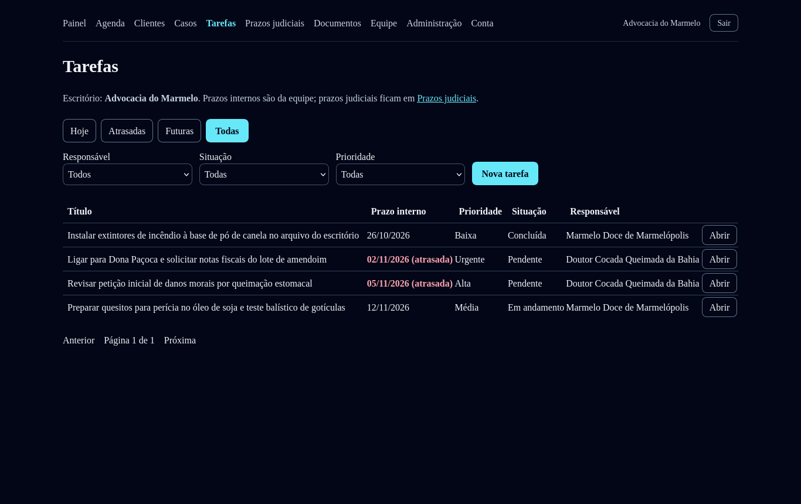
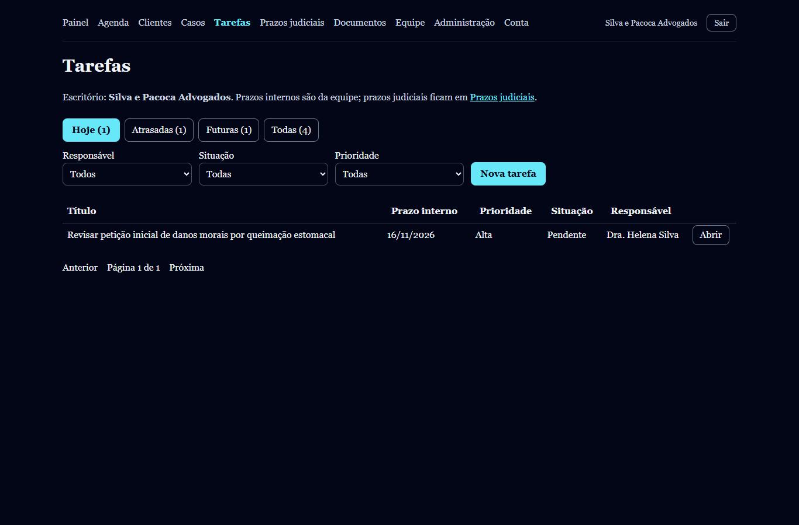
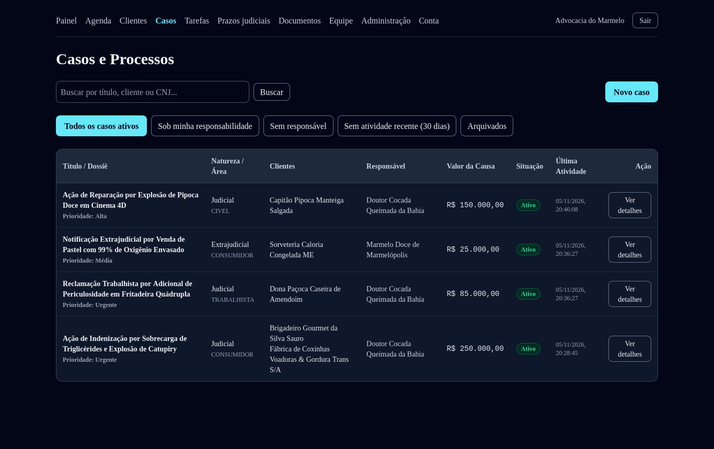
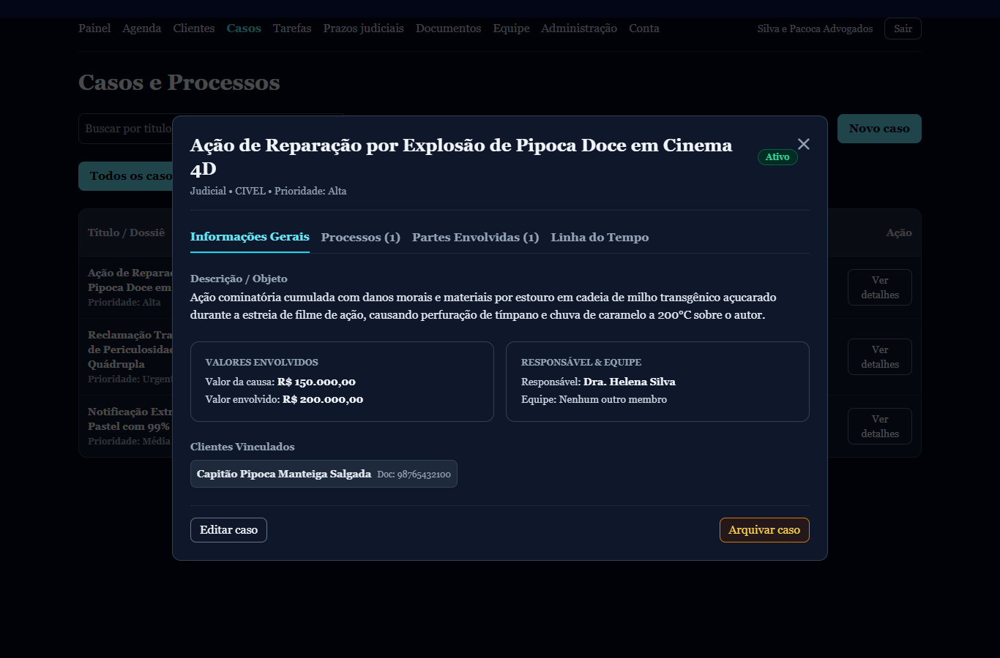
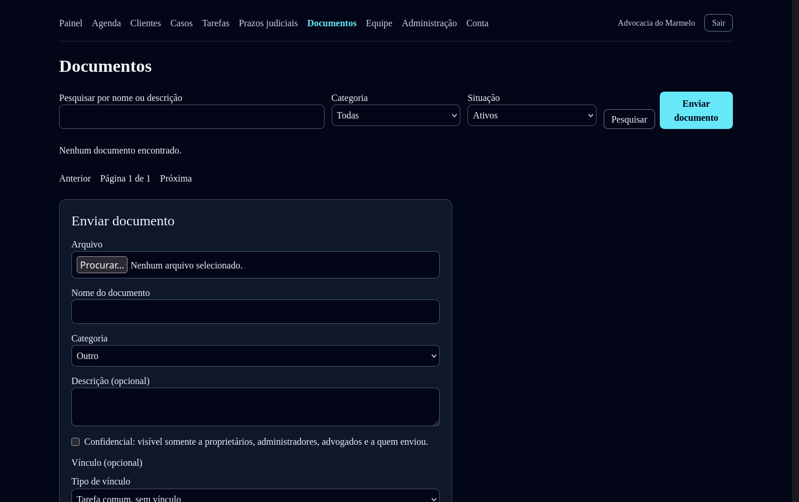
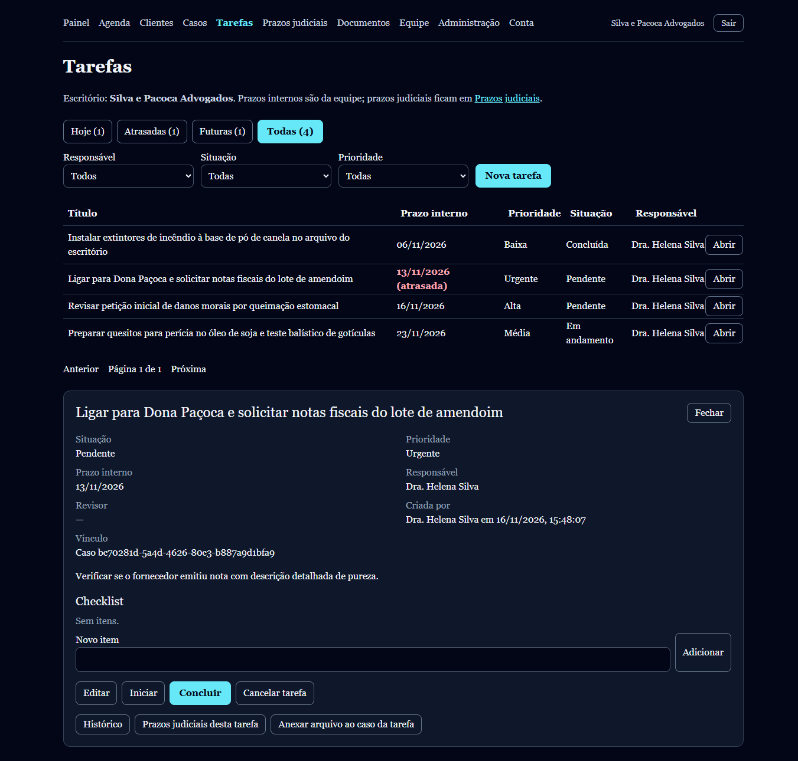
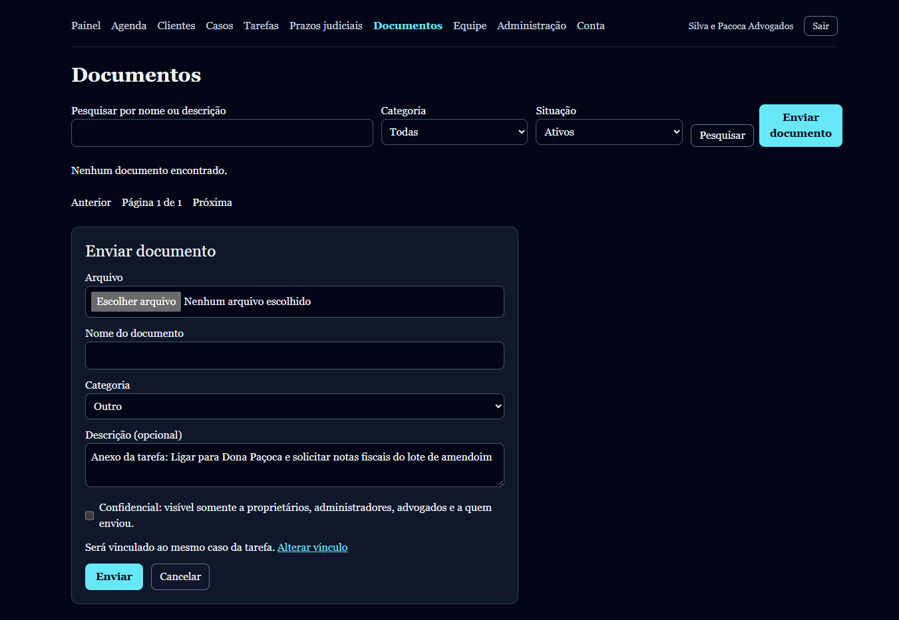
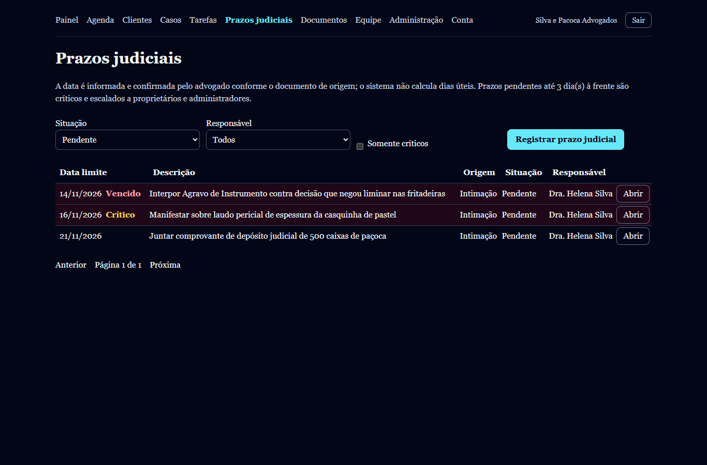

# Entrega 5 — Alterações após a validação com usuários

Este documento registra o que mudou no MVP depois dos testes da [Entrega 4](../entrega-04/Entrega-04.md)
(seção 7, "Problemas identificados e ajustes realizados"). Para cada problema há o antes, a decisão, o depois
e como a mudança foi verificada.

## Resumo

| # | Problema observado (Entrega 4) | Decisão | Situação |
| :-: | :--- | :--- | :--- |
| 1 | Aba "Hoje" vazia passou a impressão de que não havia tarefas (U05) | Mostrar a quantidade de tarefas em cada aba e indicar onde estão | Implementado |
| 2 | Participante tentou abrir o caso clicando na linha da tabela (U01) | Tornar a linha inteira clicável | Implementado |
| 3 | Para anexar a minuta foi preciso trocar de tela e refazer o vínculo (U02) | Atalho "Anexar arquivo" dentro da tarefa, já vinculado ao mesmo cliente, caso ou processo | Implementado |
| 4 | Pergunta sobre contagem de dias úteis e feriados (U04) | Manter a data informada e confirmada pelo advogado, com destaque de prazo crítico | Mantido sem mudança |
| 5 | Exportação da pauta semanal (citada na decisão da Entrega 4) | Adiada para depois do MVP | Não implementado |

## 1. Contador de tarefas em cada aba

**Antes:** a tela de tarefas abre na aba "Hoje". Quando não havia tarefas para o dia, a lista aparecia vazia
e não indicava que existiam tarefas atrasadas ou futuras. O participante U05 concluiu que o escritório não
tinha tarefas cadastradas.

**Depois:** cada aba mostra quantas tarefas contém, por exemplo `Hoje (1)`, `Atrasadas (1)`, `Futuras (1)`
e `Todas (4)`. As contagens respeitam os filtros de responsável, situação e prioridade. Se a aba atual estiver
vazia, a tela informa quantas tarefas existem em "Todas" e oferece o atalho para essa aba.

**Como foi feito:** a consulta de tarefas passou a devolver também a contagem de cada período, calculada com
os mesmos filtros e somente no escritório da sessão.

**Verificação:** teste de tela "mostra quantas tarefas há em cada aba e indica onde estão quando a aba atual
está vazia" e verificação em banco real (`verify:tasks-documents`), que confere as contagens e que outro
escritório vê zero tarefas.

## 2. Linha da tabela de casos clicável

**Antes:** os detalhes do caso só abriam pelo botão "Ver detalhes", no fim da linha. O participante U01 clicou
no título do caso e nada aconteceu.

**Depois:** clicar em qualquer ponto da linha abre os detalhes do caso. O botão "Ver detalhes" continua
disponível para quem navega pelo teclado.

**Verificação:** teste de tela "abre os detalhes ao clicar em qualquer ponto da linha do caso".

## 3. Atalho para anexar arquivo a partir da tarefa

**Antes:** para anexar a minuta de uma tarefa, a participante U02 precisou sair da tarefa, abrir Documentos,
iniciar um envio e procurar novamente o caso para fazer o vínculo.

**Depois:** os detalhes da tarefa mostram o botão "Anexar arquivo ao caso da tarefa" (ou ao cliente ou
processo, conforme o vínculo da tarefa). O botão abre o envio de documento já vinculado ao mesmo registro e com
a descrição "Anexo da tarefa: …". O vínculo pode ser trocado em "Alterar vínculo". Tarefas sem vínculo mostram
"Anexar arquivo" e abrem o envio sem vínculo.

**Verificação:** testes de tela "atalho de anexo leva ao envio de documento com o vínculo da tarefa" e "abre o
envio já vinculado quando chega pelo atalho da tarefa", que confere o vínculo enviado ao servidor. O servidor
continua validando que o caso pertence ao escritório antes de aceitar o documento.

## 4. Contagem de dias úteis

**Decisão:** sem mudança. Calcular dias úteis exige calendários de feriados e suspensões de cada tribunal, com
fontes confiáveis. Um erro nesse cálculo pode fazer o escritório perder um prazo. O MVP mantém a regra
definida desde a Entrega 3: o advogado informa a data e confirma que a conferiu no documento de origem. O
sistema destaca prazos vencidos e críticos (até 3 dias) no painel e nos lembretes.

## 5. Exportação da pauta semanal

**Decisão:** adiada. A exportação foi citada na decisão da Entrega 4, mas não apareceu como dificuldade nos
testes. O grupo priorizou os três ajustes que impediram ou atrasaram tarefas dos participantes.

## Verificação geral

- Testes automatizados: 662 no backend e 163 no frontend, todos aprovados, sem erros de lint, tipos ou build.
- Verificações em PostgreSQL real descartável: clientes, casos e processos, tarefas, prazos e documentos.
- Telas capturadas com o sistema rodando conforme o README: [evidencias/entrega-05](../../evidencias/entrega-05).
